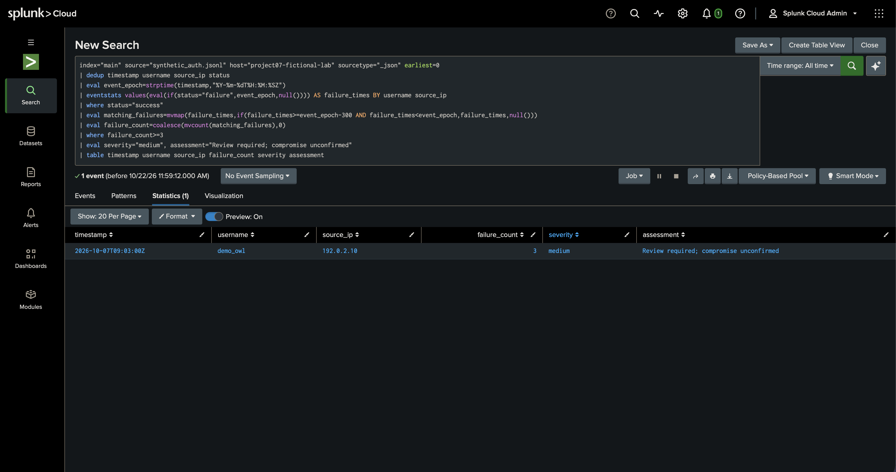

# Synthetic SIEM-style alert investigation

A SOC learning project using entirely fictional authentication events.
It extends project 06 with offline Python correlation and an assistant-guided
Splunk Cloud lab run on 22 October 2026. The lab ingested seven fictional
events and reproduced the expected single match. It does not ingest live
telemetry, establish a real incident, or demonstrate production SOC experience.

## Scenario and result

The invented account `demo_owl` records three failed logins from
`192.0.2.10`, followed by a success at 09:03 UTC on October 7, 2026.
The rule emits one **Medium** alert. The simulated analyst disposition is
**suspicious authentication; compromise unconfirmed**.

Read [the investigation](investigation.md) for the timeline, competing
explanations, triage, severity, and proposed response. Read
[the detection specification](detection.md) for exact rule semantics.

## Repository structure

```text
projects/
    06-auth-log-parser/
        auth_parser.py                 # existing dependency, unchanged
    07-siem-alert-investigation/
        README.md
        detection.md
        investigation.md
        detect.py
        synthetic_auth.jsonl
        example_alerts.json
        test_detect.py
        validation.md
```

The existing project's other files remain in place. This project imports its
`parse_event` function using a path relative to this script. No copying or
modification of project 06 is required in the repository.

## Run on Mac or Linux

Use Python 3 with the standard library; no packages, API keys, elevated access,
network requests, or security product account are required.
From the repository root:

```bash
python3 projects/07-siem-alert-investigation/detect.py projects/07-siem-alert-investigation/synthetic_auth.jsonl
python3 -m unittest discover -s projects/07-siem-alert-investigation -p 'test_*.py' -v
```

Optional comparison with the earlier parser:

```bash
python3 projects/06-auth-log-parser/auth_parser.py projects/07-siem-alert-investigation/synthetic_auth.jsonl
```

Project 06 flags the source's three failures across the whole file.
Project 07 additionally requires a later success for the same username and IP
within a bounded interval. Neither output establishes an attack.

The complete observed JSON is in [example_alerts.json](example_alerts.json).
Its key results are seven unique valid events, zero rejected records, zero
duplicates, and one alert `SYN-AUTH-001-L004`, referencing failure lines
1, 2, 3 and success line 4. Line numbers are one-based input references.
The other three events do not meet the rule.

To save another report, redirect to a new filename, never the input filename.
Exit code 0 means processing completed, including when bad records were skipped;
1 means the dependency or input could not be read; 2 means CLI arguments are
invalid. Inspect data-quality counters even if the alert list is empty.

## Safe data and honest portfolio use

All names, dates, addresses, events, and case context are invented. The IPv4
addresses use documentation ranges. No real account was accessed and no
containment action was performed. Do not add real logs, secrets, tokens,
customer details, employer information, or screenshots containing private data.
Validation checks structure, not whether data is safe to publish.

Suggested interview description after reviewing and running it yourself:

> I studied an offline SIEM-style authentication investigation using fictional
> logs. The project correlates repeated failures with a later success, tests
> rule boundaries, and distinguishes an alert match from confirmed compromise.

Do not describe this as operating a production SIEM or responding to a real
breach. Execution evidence from project preparation is recorded separately in
[validation.md](validation.md).

On 15 October 2026, Gurdit Singh ran this project on his Mac with Python 3.9.6:
**10 tests passed**, and the generated one-alert report matched the example.
See the screenshot-reviewed [owner-local execution record](../../docs/execution-evidence/2026-10-15-owner-mac/README.md).
A follow-up [comparison on Project 06's input](../../docs/execution-evidence/2026-10-15-owner-mac/detection-comparison.md)
produced no alerts and illustrates why grouping by account and IP matters.

## Splunk Cloud lab — 22 October 2026

During an assistant-guided session using Safari on my Mac, the assistant
uploaded the fictional dataset to my Splunk Cloud trial and ran the searches.
I captured the screenshot below. The execution record distinguishes assistant
operation from my independent execution.

| Check | Observed result |
|---|---|
| JSON ingestion | 7 events; source type `_json`, index `main` |
| Threshold 3 | 1 match: `demo_owl`, `192.0.2.10`, 09:03 UTC, 3 failures |
| Threshold 4 | 0 results |
| Restore threshold 3 | Original single match returned |
| Saved report | Project 07 - Synthetic Authentication Correlation |

The Splunk result matched the Python detector on this fixture. The report is
for manual use; no scheduled alert or notification was configured.



Read the [execution record](../../docs/execution-evidence/2026-10-22-splunk-cloud/README.md)
and use the [executed SPL](splunk-search.spl) to repeat the search with All time
selected. Upload the dataset only once; repeated uploads create duplicate raw
events even though this query deduplicates matching field tuples.

### Interpreting the result

- `demo_owl` meets the rule: three failures followed by success within five minutes.
- `demo_fox` has only one preceding failure and does not meet the threshold.
- `demo_badger` has no preceding failures and does not meet the threshold.
- A matching sequence warrants review; it does not prove compromise.

These explanations were developed during guided practice. The original Python
tests cover boundary conditions; the October 22 SPL run covered the supplied
seven-event fixture and threshold-4 variation. The additional October 23 run is documented below.

## Splunk boundary validation — 23 October 2026

The assistant subsequently ran a separate 36-record fictional fixture in the
owner’s authorized Splunk Cloud trial through Safari. Observed: 36 raw events,
35 unique tuples, all 10 success-event diagnostics matching expected failure
counts and ages, four qualifying successes at threshold 3, and zero at threshold
4. Restoring threshold 3 returned the same four rows. The original candidate
and a separately labeled UTC-explicit variant both passed these cases.

The checks cover the inclusive 300-second boundary, excluded 301-second and
same-second failures, username/IP isolation, duplicate tuples, unsorted input,
multiple successes without a reset, and the two-failure negative control.
Read the [observed execution record and evidence](../../docs/execution-evidence/2026-10-23-splunk-boundaries/EXECUTION-RECORD.md)
and [repeatable run sheet](splunk/boundary-validation/RUN-SHEET.md). Expected
outcomes remain separate from the CSV exports and completed comparisons.
This was assistant-operated, not an independent owner rerun or production test.

## Limitations and next lab

This is a small batch correlation exercise with a manual Splunk Cloud lab run.
The input schema has no host, application, session, event ID, device, MFA, or
endpoint fields. It assumes one authentication service and one UTC clock.
See detection.md for deduplication, false positives, false negatives, and
performance limits. The simulated investigation deliberately leaves uncertainty
unresolved instead of inventing user interviews or endpoint findings.

Next: document an independent owner rerun and extend coverage beyond the
completed synthetic boundary fixture. Scheduled alerting and production deployment remain outside
the completed scope. See the execution record for timestamp parsing, schema
validation, and search-memory limitations of this small lab query.
